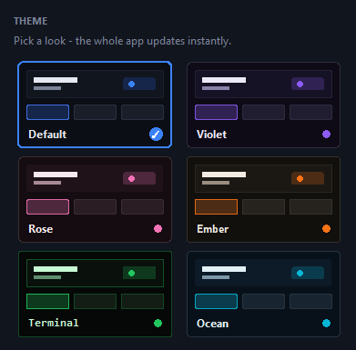
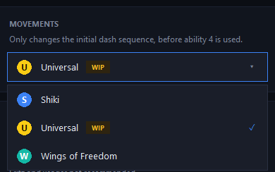
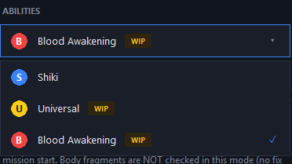
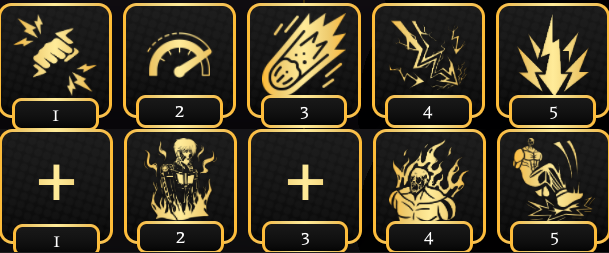
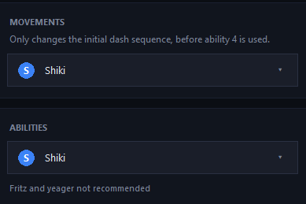
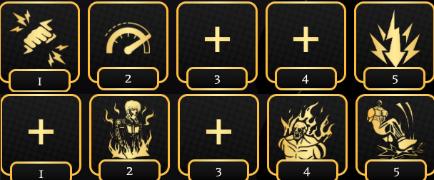
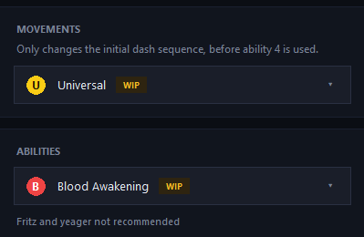

AOTR mission macro with a clean status window. Uses external keyboard/mouse input only.

## Features
- Automatic mission routine (abilities, dashes, strafes, shift) with RETRY detection
- Tracks completed / failed missions and loot (scrolls and fragments)
- Detects being grabbed and presses your escape key
- Optional Discord webhook: stats after every mission, periodic stats graph, error pings
- Configs: **Shiki**, **Universal** (WIP), **Blood Awakening** (WIP)
- Rebindable hotkeys and in-game keys in Settings

### Supports various themes


### Adapts to different types of movements


### Adapts to different types of playstyles


## Builds/layout (Important
 ### Shiki:



- Recommended to use   ; Can use artifacts with TS stats too
- Must have Founder's blessing ; better if you have avatar of ymir
- Recommended to use cloak (not scorched cloak)
- in config select Shiki on both Movement and Abilities
- Recommended to use Afterimages

 ### Blood awakening:



- Not a lot of requirements for it but try to avoid using Frtiz/Yeager.
- Use your best Shifter Build for colossal titan. Avoid Tatsujin/Flashsteps/Wings of freedom
- If you use wings of freedom select that in config


## Requirements
- Windows, Python 3.10+
- Roblox in windowed / borderless mode

```
pip install -r requirements.txt
```

## Run
```
python main.py
```
Default hotkeys: `F8` start, `F6` pause / resume, `F7` stop (changeable in Settings).

Keep the template images (`retry_text.png`, `mission_start.png`, `result_*.png`,
`loot_*.png`, `grabbed_text.png`, `ymir_logo_app.png`, `ymir.ico`) next to `main.py`.

## Build an exe
Double-click `build.bat`. The result is `dist\ymir.exe`.

## Notes
- Settings and stats are saved in `aotr_stats.json` next to the script / exe. It can hold
  your webhook URL, so it is in `.gitignore` - don't share it.
- Slamming the mouse into a screen corner aborts the macro (pydirectinput failsafe).
- Use at your own risk; macros can break a game's rules.
